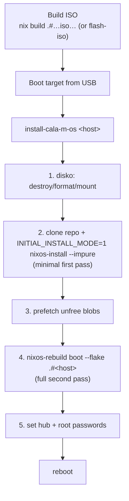
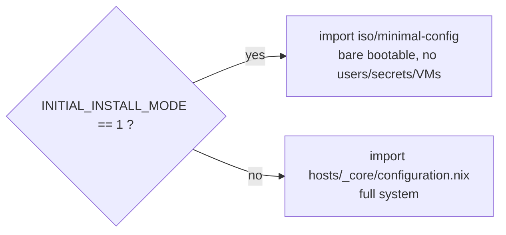

# ISO & Installer

Cala-M-OS ships a custom installer ISO that you can SSH into using only a Yubikey, and a **two-pass install** that bootstraps a minimal system before building the full configuration.



---

## Building the ISO

```bash
nix build .#nixosConfigurations.iso.config.system.build.isoImage   # == nix build .#default
# or, interactively build + flash to USB:
nix develop -c flash-iso
```

The ISO is also the flake's `packages.default`. `flash-iso` is documented in [[Flake & Inputs|Flake-and-Inputs]].

---

## Proton PAT on the media → private flake inputs (`iso/calapat.nix`)

Hosts with a **private** `github:` input (tci-cloud's `cobblemon-initiative`, battlestation/devbox's `bookkeeper`) can't be evaluated without a GitHub `access-tokens` line, and that line lives in Proton Pass (vault `Cala-M-OS`, item `nix-github-token`, field `secret`, the same item [[Secrets & Security|Secrets-and-Security]] uses). When the install media carries a Proton Pass PAT, the live installer logs in with it and fetches the line:

| PAT source | Written by | Use |
|---|---|---|
| `/iso/calapat/pat` inside the ISO | `build-pat-iso` | an ISO **file**, for cloud custom-ISO slots (a virtual CD-ROM has no partition table, so a CALAPAT partition is invisible) |
| `CALAPAT`-labelled partition | `flash-iso --with-pat` | a USB stick |

- `cala-nix-token` runs at boot (`cala-nix-token.service`, retrying while the network is down and giving up on errors a retry can't fix) and again, synchronously, from an `install-cala-m-os` shim before the install starts. It logs in with its own throwaway session, logs out, and writes `/dev/shm/cala-install/nix-access-tokens.conf` (root, 0600) in canonical `access-tokens = host=token` form.
- The live `nix.conf` `!include`s that file. The shim also exports it as `NIX_USER_CONF_FILES`, because Step Four's `nixos-enter` reads the **target's** `nix.conf` and mounts a fresh `/run`. It does rbind `/dev`, though, so `/dev/shm` survives into the chroot, and the environment is inherited.
- `PROTON_PASS_PAT_FILE=/iso/calapat/pat` is set system-wide, so cala-installer's own Proton step for online hosts picks up the same PAT.
- With no PAT on the media nothing changes: the service exits and Nix ignores the missing include.
- The token is never written to the target or the store; it lives in RAM for the length of the install.

### Building one: `build-pat-iso`

Anyone holding the ISO can use the PAT, and Proton PAT grants are per vault. So the ISO should carry a PAT that can only read the token: put a copy of `nix-github-token` in its own vault, create a plain (non-agent) PAT with a short expiry, and grant it **viewer on that vault only**. The vault has to be granted as a whole; `--vault-name` lookups don't see item-only grants.

```bash
nix develop -c build-pat-iso --vault Cala-M-OS-Install       # prompts for the PAT; writes ~/cala-m-os-installer-pat.iso (0600)
nix develop -c build-pat-iso --vault Cala-M-OS-Install --pat-file ~/pat --out /path/on/share/installer.iso
#   --shared-vault          read the shared Cala-M-OS vault instead (exposes whatever the PAT is granted there)
#   --item/--field          a differently named token item (default nix-github-token / secret)
#   --no-check              skip the pre-flight check (offline build)
```

Before building, it does what the installer will do: it logs in with the PAT in a throwaway session and reads the token item, so a bad PAT or a missing grant fails here rather than on the cloud box. It then builds the normal ISO and uses xorriso to add `/calapat/` (root-only) to a **copy** outside the nix store, replaying the original El Torito/MBR/GPT boot records. Before writing the output it verifies the PAT reads back and the boot setup matches the original. It refuses to write inside the flake.

> Revoke the PAT after the install, and delete the ISO from the share and from the provider. Exception: if you install an online-secrets host from this ISO, cala-installer seeds the PAT onto it, so revoking it would cut that host off.

### Hetzner Cloud (tci-cloud, webhost)

The two Hetzner Cloud hosts share `machines/modules/hetzner-cloud` (see [[Machines|Machines]]): systemd-networkd for Hetzner's **routed (Layer 3)** network. Hetzner notes that "the Cloud Server network model is always based on Layer 3, so automatic network configuration may fail with some custom operating systems": the public IPv4 is a /32 whose gateway (172.31.1.1) is outside it, and IPv6 is configured statically (no router advertisements are documented or observed). The module runs IPv4 over Hetzner's DHCP (systemd-networkd handles the off-subnet gateway) until the host sets `calamoose.hetznerCloud.ipv4Address`, which turns DHCP off and writes the static /32 + on-link default route; IPv6 exists only once `ipv6Address` is set (static, gateway `fe80::1`). A first install therefore runs on DHCP; fill the addresses in afterwards and redeploy, and publish AAAA records only once `curl -6` works on the box.

**Preferred first install — nixos-anywhere from Hetzner's Rescue system** (no custom ISO, no support ticket). Each host's header has the exact commands; in short: create the server with no Volumes attached, point DNS at its IPv4, enable Rescue with your SSH key, reset into it, confirm it boots UEFI (`ls /sys/firmware/efi`; CPX/CCX/CAX do, the CX line does not), then from devbox `nix run github:nix-community/nixos-anywhere -- --flake .#<host> --target-host root@<ipv4>` (`--build-on remote` for the aarch64 webhost; `sudo --preserve-env=SSH_AUTH_SOCK …` for tci-cloud, whose private `cobblemon-initiative` input only root's nix can fetch). nixos-anywhere kexecs the rescue system into a NixOS installer, applies the host's disko layout (`/dev/sda`) and installs the full configuration in one pass.

**Alternative — the PAT-bearing ISO** (needed only when the box must install itself, e.g. tci-cloud without a devbox at hand):

1. Put the ISO on the share behind a **direct-download** link that needs no login. Then open a Hetzner support ticket (project → Support → "Miscellaneous") with the link and "x86". The ISO becomes private to the project; the API can't upload or delete ISOs, so removal also takes a ticket.
2. Server → ISO Images → mount it, then reboot. It boots under UEFI from a virtual CD (`/dev/sr0`); the root disk stays `/dev/sda`. Use the web console (noVNC).
3. Pick the host in cala-installer. The HETZNER machines can't set `wipeAllDisks` (that needs a `/dev/disk/by-id` pin, and the root disk's by-id name varies between Hetzner servers), so the TUI runs disko itself for them: disko lists the device it is about to erase and asks for a typed `yes`, then the install continues with `INSTALL_SKIP_DISKO=1`. The same by hand, from **Drop to a shell**:
   ```bash
   sudo -i
   disko --mode destroy,format,mount --flake github:CalamooseLabs/cala-m-os#tci-cloud
   INSTALL_SKIP_DISKO=1 install-cala-m-os tci-cloud
   ```
   `journalctl -u cala-nix-token` shows whether the GitHub token was fetched. `cala-nix-token` retries it by hand.

**Reinstall** — `sudo cala-reinstall` on the box (below), then the same install from the kexec'd installer. tci-cloud holds no GitHub token of its own (`enableSecrets = false`), so pass `--token-file`; webhost has no private inputs, so `--no-token`.

---

## Reinstall in place: `cala-reinstall` (no USB or ISO)

**Every physical host** has `cala-reinstall` (`modules/cala-reinstall`, imported by `hosts/_core/non-vm.nix`; microVM guests don't — their root image is rebuilt by the parent host). It turns the running host back into the installer: it kexecs into a RAM-only build of the same installer, the flake output `installer-kexec` (`iso/kexec.nix`, a netboot image that keeps the whole store in the initrd). This suits remote boxes and cloud VMs, where there is nothing to plug in.

The image comes in two flavours and two architectures: `installer-kexec` carries linux-firmware (a bare-metal NIC may need a blob to come back with network), `installer-kexec-vm` leaves it out (`iso/kexec-vm.nix`) and is about half the size — what fits a 4 GB cloud VM. `cala-reinstall` picks `vm` by itself when `systemd-detect-virt` reports a VM (`--variant full|vm` overrides; `programs.cala-reinstall.variant` sets the default), and `<flake>#installer-kexec[-vm]` resolves through `packages.<system>` to the host's own architecture (`installer-kexec-aarch64` / `installer-kexec-vm-aarch64` behind it, for webhost).

```bash
sudo cala-reinstall --dry-run     # build the payload and load the image, then unload it
sudo cala-reinstall               # type the hostname to confirm; the session drops
#   --flake REF | --image DIR      where the kexec image comes from (default: github:CalamooseLabs/cala-m-os)
#   --variant full|vm              with / without linux-firmware (default: vm on a virtual machine, else full)
#   --token-file / --pat-file      what it carries for private inputs (default: the host's own)
#   --no-token                     go ahead with neither (hosts without private inputs)
#   --no-keys / --no-network       don't carry SSH keys / static addresses
```

It appends a small payload to the image's initrd. The installer copies it to `/var/lib/cala-reinstall` (`cala.installer.mediaDir`):

| Carried | From | Used for |
|---|---|---|
| `nix-access-tokens.conf` | this host's `nix config show access-tokens` (or `--token-file`) | private flake inputs; no Proton round trip |
| `pat` | `/var/lib/proton-pass-cli/pat` (or `--pat-file`) | fetching the token itself; seeded onto an online-secrets host it reinstalls |
| `authorized_keys` | the host's plain SSH key lines | extra root keys in the installer |
| `ssh/ssh_host_*` | `services.openssh.hostKeys` | the same host key, so `known_hosts` still matches |
| `network` | static (never-expiring) global addresses, default gateways and DNS, keyed by NIC MAC | a NetworkManager profile per NIC (matched by MAC); DHCP/RA networks need none |
| `hostname` | | the login hint in the installer |

- **Nothing on disk changes until you run the install.** A hard reset before then boots the old system.
- It refuses to run when it would carry neither a token nor a PAT, unless you pass `--no-token`. **tci-cloud holds no token** (`enableSecrets = false`), so give it `--token-file` (copy over an `access-tokens = github.com=…` line) or `--pat-file`.
- The installer comes up with SSH (same host key, the host's keys plus the YubiKey keys) and the TUI on the console. Then install as usual: pick the host in the TUI — for the Hetzner hosts (`wipeAllDisks = false`) it runs disko itself and asks for a typed `yes`, then continues with `INSTALL_SKIP_DISKO=1`; the shell steps above remain the manual alternative.
- It needs RAM: the full initrd is about 1.4 GB because it includes linux-firmware, like the ISO, and the installer briefly holds it twice, so the full image needs roughly 4 GB; the `vm` flavour is about half that. It checks first and refuses when the box is short.
- Kexec skips the firmware reset. That's fine for VMs, but on a workstation with a GPU, rebooting into a USB or ISO is safer.
- A host that uses Hetzner's DHCP carries no static addresses (DHCP networks need none); one with `calamoose.hetznerCloud.ipv4Address` / `ipv6Address` set carries them, and the installer restores them as a NetworkManager profile with the off-subnet gateway.
- The aarch64 image and the kexec on a Hetzner CAX box are untested so far (the x86 QEMU test below is what has been run); treat the first webhost reinstall as a smoke test with the web console open.
- Static addresses become one NetworkManager profile per NIC, matched by MAC, so a renamed or late-appearing NIC still gets them. A NIC that also had DHCP keeps DHCP alongside them. Addresses on VLANs, bonds or bridges without a physical member aren't carried; it says so.
- The default flake ref only has the `installer-kexec*` outputs once they are on master. Until then use `--flake github:CalamooseLabs/cala-m-os/<branch>`.

Tested in QEMU, from a static-IP NixOS VM:
- After the jump, the host key was unchanged and root SSH worked with the carried key.
- The static address was restored onto the renamed NIC (eth0 → ens3) by MAC, and GitHub was reachable.
- The carried token reached Nix.
- A dry run leaves nothing loaded, and it refuses to run with no token.
- A reset booted the old system with the same host key.

---

## What's on the ISO (`iso/default.nix`)

- Based on `installation-cd-minimal.nix`; flakes + `nix-command` + `allowUnfree`.
- **SSH forced up** (`sshd.wantedBy = ["multi-user.target"]`); root authorized keys are the two `sk-ssh-ed25519` FIDO2 keys in `iso/public_keys/`; `pcscd` enabled. → You can SSH into the live installer with only the Yubikey.
- Hostname `cala-m-os-installer`; `forceTextMode`; `lz4` squashfs.
- Packages: `disko`, `git`, `neovim`, hardware-inspection tools, and antlers' `install-cala-m-os` (with its bash-completion), `cala-installer` and `proton-secrets` — built by `pkgs.callPackages` on antlers' `flakes/scripts/package.nix` (and `callPackage` on `flakes/proton-secrets/package.nix`) against the image's own package set rather than antlers' x86_64-only `packages.<system>`, which is what lets the aarch64 kexec image exist.
- **Every host and machine is offered**: `iso/installer.nix` computes `CALA_INSTALLER_HOSTS` (every `nixosConfigurations` entry except the installer images), `CALA_INSTALLER_MACHINES` and `CALA_INSTALLER_VM_MACHINES` (the `machines/workstations` and `machines/vms` directories) from the flake and exports them; cala-installer's pickers and the `install-cala-m-os` bash completion read them, and once online cala-installer refreshes both from the flake ref it installs from, so a host added upstream shows up without a new image.

> The `iso` config is built directly (not via `mkSystem`) and gets only `inputs` in `specialArgs` — no `cala-m-os`, no `initialInstallMode`.

---

## `install-cala-m-os <host>` — step by step

| Step | Action |
|------|--------|
| **1. Format** | `disko --mode destroy,format,mount --flake github:CalamooseLabs/cala-m-os#<host> --yes-wipe-all-disks` — pulls the host's disko layout from GitHub and partitions/mounts at `/mnt` |
| **2. Minimal install** | clone repo to `/mnt/etc/nixos`, then `INITIAL_INSTALL_MODE=1 nixos-install --flake /mnt/etc/nixos#<host> --impure --no-root-password` |
| **3. Prefetch** | `nix-prefetch-url file:///mnt/etc/nixos/prefetch/displaylink-620.zip` (host + inside `nixos-enter`) — pre-seeds the unfree DisplayLink blob |
| **4. Full build** | `nixos-enter -- nixos-rebuild boot --flake /etc/nixos#<host>` — the full config (all users/modules/secrets/VMs) becomes the boot generation |
| **5. Passwords** | prompt + confirm, then `chpasswd` for `hub` and `root` |

Then reboot.

Notes:
- The ISO auto-starts the `cala-installer` TUI on tty1 (a gum front-end over `install-cala-m-os`): pick the host, then **"Use the host's default machine"** for any existing host. The **"Generate a fresh config for THIS box (self)"** choice is for brand-new hardware only — it neither sets `wipeAllDisks` nor pins the disk by id, so it cannot install a host like `homelab`.
- Hosts whose `calamoose.install.wipeAllDisks` is `false` (the default; the Hetzner cloud hosts, dual-boot boxes) can't be wiped unattended by `install-cala-m-os`. The TUI runs `disko --mode destroy,format,mount` for them itself — disko shows the device(s) and asks for a typed `yes` — and then installs with `INSTALL_SKIP_DISKO=1`. Only `battlestation`, `broadcast` and `homelab` set `wipeAllDisks = true`.
- The first (minimal) pass uses the flake's pinned `disko` input, so it needs nothing beyond the clone.
- Reinstalling onto a **replaced OS disk**: the machine's `disko.nix` pins the drive by id; pass the new path with `sudo INSTALL_OS_DISK=/dev/disk/by-id/... install-cala-m-os <host>` — variable after `sudo` — (MS-02 supports this; a non-by-id value is refused) and update the pin afterwards. Full homelab procedure: [[Disaster Recovery|Disaster-Recovery]].
- The password entered in Step 5 is `hub`'s password of record: `users.mutableUsers` is on, so the `admin_password` secret only seeds accounts that are created while it is readable.

---

## Machine override — build a host onto different hardware

A host has a **default** machine (its `machine_uuid`), but you can override which machine it builds to at install time — e.g. to try the `devbox` software stack on an `MS-01` box:

```bash
sudo install-cala-m-os devbox MS-01
```

The optional second argument is any directory name under `machines/workstations/` or `machines/vms/` (the type — Workstation vs VM — is auto-detected from which folder contains it). Tab-completion offers the machine list.

How it flows:

```mermaid
flowchart TD
  A["install-cala-m-os devbox MS-01"] --> B["export MACHINE_OVERRIDE=MS-01"]
  B --> C["disko (--impure) → formats MS-01's layout"]
  B --> D["nixos-install (--impure) → minimal MS-01"]
  B --> E["write machine-override.nix:<br/>{ devbox = \"MS-01\"; }"]
  E --> F["nixos-rebuild boot (--impure) → full MS-01"]
  E --> G["future rebuilds on the box<br/>read the file → stay on MS-01"]
```

- **Live (install):** the `MACHINE_OVERRIDE` env var is read by `flake.nix` (`builtins.getEnv`, like `INITIAL_INSTALL_MODE`) and injected via `specialArgs`. Because disko evaluates with `--impure` and both install passes pass `--impure`, every step resolves to the overridden machine.
- **Persistent (after install):** the installer writes a per-host entry into `machine-override.nix` on the target, so future `nixos-rebuild` on that box keeps targeting the override without the env var. The env var takes precedence over the file.

Resolution lives in `machines/resolve.nix`, used by both `hosts/_core/configuration.nix` and the minimal install config, so the override applies to the disko/hardware in both passes. See [[Machines|Machines]] and [[Configuration Hierarchy|Configuration-Hierarchy]].

> **Persisting without reinstalling:** add an entry to `machine-override.nix` directly, e.g. `{ devbox = "MS-01"; }`, and rebuild. Remove it to revert to the host default.

---

## `INITIAL_INSTALL_MODE` — the two-pass switch

The flake reads the env var at eval time (impure, hence `--impure`):

```nix
initialInstallMode = builtins.getEnv "INITIAL_INSTALL_MODE" == "1";
```

It threads into every host's `specialArgs` and drives the branch in `_core/default.nix`:



It also:
- **gates VM stacks**: `lib.optional (!initialInstallMode) ./vms.nix` on `homelab` and `livedata` — VMs (which depend on host secrets) are skipped on the first pass.
- **propagates into guests**: `cala-vm-manager` re-injects `initialInstallMode` into each guest's `specialArgs`.

This is what lets a brand-new machine reach a bootable state **before** the Yubikey-backed secrets and VMs come online. The second pass (env var unset) builds everything.

---

## `iso/minimal-config/configuration.nix`

The minimal first-pass system: takes `{machine_type, machine_uuid}`, computes the machine path, and imports `_core/options.nix` (so `calamoose.enableSecrets` exists), the machine's `hardware-configuration.nix`, the disko module + the machine's `disko.nix`. Sets systemd-boot/EFI, NetworkManager, timezone, flakes, `allowUnfree`, `pcscd`, and packages `disko` + `git`. Bootable and disko-aware, but no users or secrets.

---

## Post-install key setup

After first boot, restore the Yubikey-backed keys (also in the README):

**GPG signing key**
```bash
sudo cp /run/agenix/yubigpg.asc .
sudo chown <you>:users yubigpg.asc
gpg --import yubigpg.asc
rm yubigpg.asc
```

**SSH (FIDO2 resident keys)**
```bash
cd ~/.ssh
ssh-keygen -K                 # pull resident keys off the Yubikey
eval "$(ssh-agent -s)"
# rename to id_ed25519_sk{,.pub}
ssh-add ~/.ssh/id_ed25519_sk
```

See [[Secrets & Security|Secrets-and-Security]] for the trust model.
