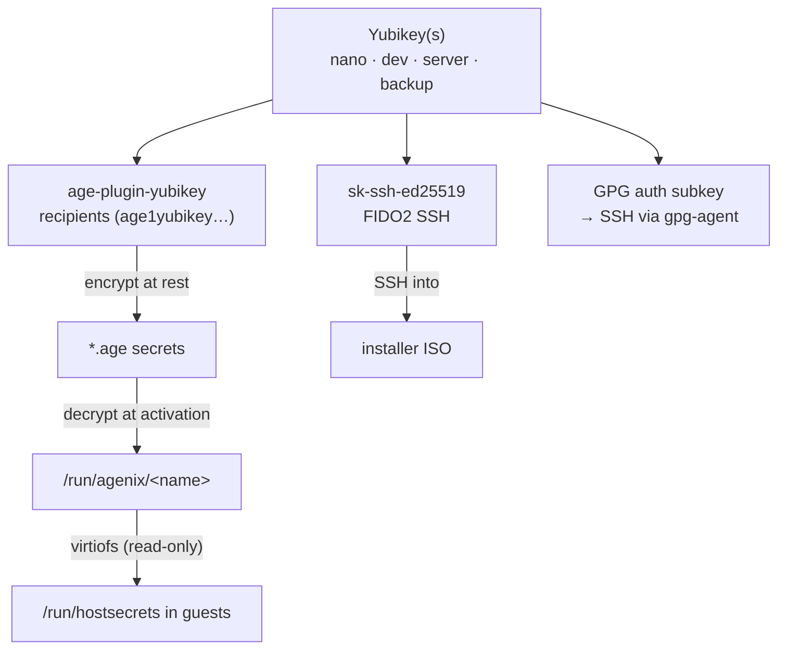

# Secrets & Security

Hardware **Yubikeys are the single root of trust**. The same physical keys provide (a) age recipients for secret encryption, (b) FIDO2 SSH keys for logging into the installer, and (c) GPG-agent-backed SSH for normal use. Secrets are managed with [agenix](https://github.com/ryantm/agenix).



---

## agenix wiring

`modules/agenix/configuration.nix` imports the agenix module and, when secrets are enabled, installs `agenix`/`age`/`age-plugin-yubikey` and configures identities:

```nix
age = lib.mkIf (config.calamoose._secretsBackend == "agenix") {
  # own store path with string context, so the stubs stay in the system closure
  identityPaths = map (k: "${./identities}/${k}.key") ["server" "yubi" "dev" "backup"];
  ageBin = "${ageWrapper}";   # Go age behind a key-aware wrapper, see below
};
```

The identity files are `age-plugin-yubikey` **stubs** (not secret) — they point at a recipient; the private key lives on the Yubikey. PIN and touch policies are **Never**, so decryption needs the physical key present but no interaction, so it runs unattended (after boot, see `agenix-rerun` below).

**Any recipient key works.** Go `age` tries the `-i` identities strictly in order and **aborts** on the first one whose YubiKey can't be opened. It does not move on to the next. With `server.key` listed first, every secret that has the server stanza used to fail on any other recipient key (`Could not open YubiKey with serial 35229074`, even with the nano plugged in). The wrapper (`ageWrapper` in `modules/agenix/configuration.nix`) asks `age-plugin-yubikey --identity` which stubs are connected and passes **only** the identities whose key is connected. A connected key that isn't a recipient of a file fails fast with `no identity matched any of the recipients` instead of prompting for an absent key, and with no identity key connected at all it names the connected serials and the ones it wanted. If the listing itself fails, it falls back to the full list. When pcscd's socket isn't there (stage-2 activation, or an install chroot that has no access to the installer's socket), it says so (`age: pcscd is not reachable …`) instead of letting the plugin blame whichever serial is first.

### The four recipients

| Identity file | Role | In which secrets |
|---------------|------|------------------|
| `yubi.key` (nano) | Always-present nano key | **every** secret |
| `backup.key` | Backup key | **every** secret |
| `dev.key` | Dev workstation | `admin_password` and homelab's `cloudflare-token` / `qbit-password` / `proton-vpn.conf` (none of the workstation secrets; those are nano + backup only) |
| `server.key` | Server | `admin_password`, homelab's `cloudflare-token` / `qbit-password` / `proton-vpn.conf`, and `protect-api-key` / `protect-admin-password` |

### Where the recipient map lives

There is **no single repo-wide `secrets.nix`**. Each secret bundle co-locates its own `secrets.nix` (the recipient list agenix reads when editing/encrypting) with a sibling `default.nix` that registers the secret into `age.secrets`. To edit:

```bash
agenix -e <file>.age -i ./identities/yubi.key   # run from the bundle dir
```

### Decryption target

agenix decrypts to `/run/agenix/<name>` (a symlink into the `/run/agenix.d/<generation>` ramfs); consumers read `config.calamoose.secrets.<name>.path`, which resolves to that path on the agenix backend.

### When decryption actually happens — `agenix-rerun`

agenix installs its secrets from a NixOS **activation script**, and activation runs from stage-2-init **before systemd starts**. `age-plugin-yubikey` talks to the key through `pcscd`, a socket-activated systemd service — so at boot the decryption always fails and `/run/agenix` starts empty (a `nixos-rebuild switch`, run with pcscd up, is what used to populate it).

`modules/agenix/configuration.nix` therefore defines `agenix-rerun.service` on every agenix host: after `pcscd.socket` it waits briefly for a YubiKey to enumerate, re-runs the exact agenix activation snippets (with retries), and fails fast if no key is plugged in. Consumers that need the secrets at boot order after it with `wants` + `after`:

- `microvm-virtiofsd@` (the `/run/hostsecrets` share into guests) — `services/vm-manager`
- `acme-order-renew-<domain>` (the Cloudflare token) — `services/certs`
- `NetworkManager` (VPN `.nmconnection` secrets) — `modules/vpn`

The installer hits the same problem: Step Five's `nixos-enter -- chpasswd` runs the full system's activation in a chroot with a fresh `/run`, where the live pcscd socket is hidden. The `install-cala-m-os` shim (`iso/tools.nix`) therefore bind-mounts `/run/pcscd` to `/dev/shm/cala-install/pcscd` (`/dev` is rbound into the chroot) and exports `PCSCLITE_CSOCK_NAME` to point at it, so the plugged-in key decrypts during the install too. Those copies live in the chroot's RAM and are gone after the install. So Step Five's `[agenix] decrypting …` lines show before the reboot whether the plugged-in key decrypts every secret. A failure there is only logged (nixos-enter ignores the activation's exit status), so look for `age:` errors under them before rebooting.

Operationally: keep the host's recipient YubiKey plugged in; if it was missing at boot, plug it in and `sudo systemctl restart agenix-rerun` (the VM host's `vm-hostsecrets-sync` is `PartOf` it and re-syncs; then restart the units that needed the secrets). Every host switch rotates the `/run/agenix.d/<n>` generation; the VM host therefore shares a stable copy (`/run/vm-hostsecrets`, refreshed in place by `vm-hostsecrets-sync` after `agenix-rerun` and by an activation snippet on every rebuild) rather than the rotating symlink, so running guests keep a current, read-only `/run/hostsecrets`.

---

## The `calamoose.enableSecrets` gate

Declared in `hosts/_core/options.nix` (default `true`). Every secret-consuming block is wrapped in `lib.mkIf config.calamoose.enableSecrets`, so flipping it to `false` skips all secret registration, the agenix install, and the VM secret share.

**Hosts with `enableSecrets = false`:** `openreturn`, `quorumcall`, `livedata`, and the keyless homelab guests `media`, `torrent`, `security` (they read host-decrypted files from `/run/hostsecrets` instead). `broadcast`, `ai` and `tci-cloud` use `"online"` (Proton Pass; on tci-cloud that covers `admin_password` and `nix-github-token`, the GitHub token for its private flake input, so the box fetches that input itself). These build without needing a decryptable Yubikey present.

---

## Secret inventory

| Secret (`.age`) | Bundle | Consumed by |
|-----------------|--------|-------------|
| `admin_password` | `users/_core/secrets/` | `users.users.*.hashedPasswordFile` |
| `work_credentials` | `users/debugger/secrets/` | CIFS mount `/mnt/nkc` |
| `proton_vpn.conf` | `users/debugger/secrets/` | debugger VPN |
| `yubigpg.asc` | `modules/gpg/secrets/` | GPG public key / owner-trust restore |
| `tailscale-preauth-key` | `modules/tailscale/secrets/` | `tailscale up --authkey` |
| `CalamooseWiFi` / `CalamooseLabs` / `NKCWiFi` / `theisenair` / `NETGEAR43` `.nmconnection` | `modules/wifi/secrets/` | NetworkManager system connections |
| `CasaMosVPN` / `NKCGateway` `.nmconnection` | `modules/vpn/secrets/` | NetworkManager VPN connections |
| `cloudflare-token` | `hosts/homelab/secrets/` | `cala-certs` DNS-01 token |
| `qbit-password` | `hosts/homelab/secrets/` | torrent VM (via virtiofs → `/run/hostsecrets`) |
| `proton-vpn.conf` | `hosts/homelab/secrets/` | torrent VM WireGuard (via virtiofs) |
| `protect-api-key` / `protect-admin-password` | `modules/unifi-protect-monitor/secrets/` (imported by `hosts/homelab/vms.nix`) | security VM camera wall, handed to the service via `LoadCredential` (via virtiofs) |

---

## Yubikey & GPG modules

**`modules/yubikey/`** — system: `services.pcscd.enable = true` (PC/SC smartcard daemon). home: installs `yubioath-flutter` (OATH GUI). No `pam-u2f` is configured.

**`modules/gpg/`** — system: `programs.gpg` with scdaemon `card-timeout=1`, `disable-ccid=true` (use the pcscd PC/SC path). home: `gpg-agent` with `enableSSHSupport = true` (the Yubikey's GPG auth subkey **is** the SSH agent) and `pinentry-curses`. Imports the `yubigpg.asc` secret.

---

## Secrets into MicroVM guests

Guests stay **keyless**. The host decrypts to `/run/agenix` (host Yubikey present at host boot), then `cala-vm-manager` shares that directory read-only into each guest over virtiofs (only when `enableSecrets`):

```nix
shares = lib.optionals config.calamoose.enableSecrets [
  { proto = "virtiofs"; tag = "agenix"; source = "/run/agenix"; mountPoint = "/run/hostsecrets"; }
] ++ vm.shares ++ …;
```

So a guest reads plaintext from `/run/hostsecrets/<name>`. Confirmed in the torrent guest:

```nix
wireguardConfigFile     = "/run/hostsecrets/proton-vpn.conf";
qbittorrentPasswordFile = "/run/hostsecrets/qbit-password";
```

(`homelab` decrypts those `hosts/homelab/secrets/` items and shares them down.) See [[MicroVMs|MicroVMs]].

---

## Installer SSH (FIDO2)

The ISO forces sshd up and authorizes the two `sk-ssh-ed25519` (Yubikey-resident FIDO2) public keys in `iso/public_keys/`, with `pcscd` enabled in the live env — so you can SSH into the live installer using only the Yubikey. See [[ISO & Installer|ISO-Installer]].

---

## Summary

Encrypt to 2–4 Yubikey recipients (nano + backup always; dev/server where relevant) → decrypt at activation into `/run/agenix` → gate everything on `calamoose.enableSecrets` → fan out to guests over read-only virtiofs at `/run/hostsecrets`. SSH and GPG ride the same hardware keys.
