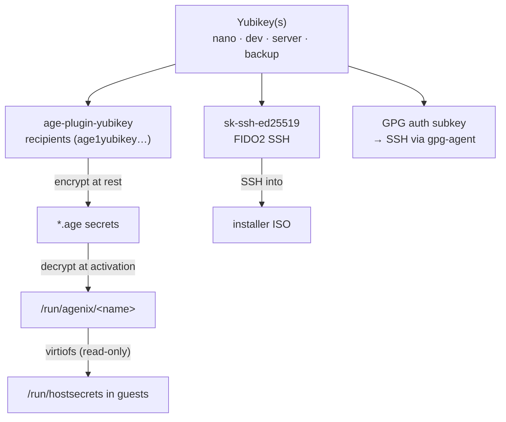

# Secrets & Security

Hardware **Yubikeys are the single root of trust**. The same physical keys provide (a) age recipients for secret encryption, (b) FIDO2 SSH keys for logging into the installer, and (c) GPG-agent-backed SSH for normal use. Secrets are managed with [agenix](https://github.com/ryantm/agenix).

Three hosts (`broadcast`, `ai`, `tci-cloud`) run the **online backend** instead: the same secret declarations are fetched from Proton Pass at run time. Everything about it, including what to do when a service has no secret after a boot, is under [The online backend (Proton Pass)](#the-online-backend-proton-pass).



---

## agenix wiring

`modules/agenix/configuration.nix` imports the agenix module and, when secrets are enabled, installs `agenix`/`age`/`age-plugin-yubikey` and configures identities:

```nix
age = lib.mkIf (config.calamoose._secretsBackend == "agenix") {
  # own store path with string context, so the stubs stay in the system closure
  identityPaths = map (k: "${./identities}/${k}.key") ["server" "yubi" "dev" "backup"];
  ageBin = "${ageWrapper}";   # Go age behind a key-aware wrapper, see below
};
```

The identity files are `age-plugin-yubikey` **stubs** (not secret) — they point at a recipient; the private key lives on the Yubikey. PIN and touch policies are **Never**, so decryption needs the physical key present but no interaction, so it runs unattended (after boot, see `agenix-rerun` below).

**Any recipient key works.** Go `age` tries the `-i` identities strictly in order and **aborts** on the first one whose YubiKey can't be opened. It does not move on to the next. With `server.key` listed first, every secret that has the server stanza used to fail on any other recipient key (`Could not open YubiKey with serial 35229074`, even with the nano plugged in). The wrapper (`ageWrapper` in `modules/agenix/configuration.nix`) asks `age-plugin-yubikey --identity` which stubs are connected and passes **only** the identities whose key is connected. A connected key that isn't a recipient of a file fails fast with `no identity matched any of the recipients` instead of prompting for an absent key, and with no identity key connected at all it names the connected serials and the ones it wanted. If the listing itself fails, it falls back to the full list. When pcscd's socket isn't there (stage-2 activation, or an install chroot that has no access to the installer's socket), it says so (`age: pcscd is not reachable …`) instead of letting the plugin blame whichever serial is first.

### The four recipients

| Identity file | Role | In which secrets |
|---------------|------|------------------|
| `yubi.key` (nano) | Always-present nano key | **every** secret |
| `backup.key` | Backup key | **every** secret |
| `dev.key` | Dev workstation | `admin_password` and homelab's `cloudflare-token` / `qbit-password` / `proton-vpn.conf` (none of the workstation secrets; those are nano + backup only) |
| `server.key` | Server | `admin_password`, homelab's `cloudflare-token` / `qbit-password` / `proton-vpn.conf`, and `protect-api-key` / `protect-admin-password` |

### Where the recipient map lives

There is **no single repo-wide `secrets.nix`**. Each secret bundle co-locates its own `secrets.nix` (the recipient list agenix reads when editing/encrypting) with a sibling `default.nix` that registers the secret into `age.secrets`. To edit:

```bash
agenix -e <file>.age -i ./identities/yubi.key   # run from the bundle dir
```

### Decryption target

agenix decrypts to `/run/agenix/<name>` (a symlink into the `/run/agenix.d/<generation>` ramfs); consumers read `config.calamoose.secrets.<name>.path`, which resolves to that path on the agenix backend.

### When decryption actually happens — `agenix-rerun`

agenix installs its secrets from a NixOS **activation script**, and activation runs from stage-2-init **before systemd starts**. `age-plugin-yubikey` talks to the key through `pcscd`, a socket-activated systemd service — so at boot the decryption always fails and `/run/agenix` starts empty (a `nixos-rebuild switch`, run with pcscd up, is what used to populate it).

`modules/agenix/configuration.nix` therefore defines `agenix-rerun.service` on every agenix host: after `pcscd.socket` it waits briefly for a YubiKey to enumerate, re-runs the exact agenix activation snippets (with retries), and fails fast if no key is plugged in. Consumers that need the secrets at boot order after it with `wants` + `after`:

- `microvm-virtiofsd@` (the `/run/hostsecrets` share into guests) — `services/vm-manager`
- `acme-order-renew-<domain>` (the Cloudflare token) — `services/certs`
- `NetworkManager` (VPN `.nmconnection` secrets) — `modules/vpn`

The installer hits the same problem: Step Five's `nixos-enter -- chpasswd` runs the full system's activation in a chroot with a fresh `/run`, where the live pcscd socket is hidden. The `install-cala-m-os` shim (`iso/tools.nix`) therefore bind-mounts `/run/pcscd` to `/dev/shm/cala-install/pcscd` (`/dev` is rbound into the chroot) and exports `PCSCLITE_CSOCK_NAME` to point at it, so the plugged-in key decrypts during the install too. Those copies live in the chroot's RAM and are gone after the install. So Step Five's `[agenix] decrypting …` lines show before the reboot whether the plugged-in key decrypts every secret. A failure there is only logged (nixos-enter ignores the activation's exit status), so look for `age:` errors under them before rebooting.

Operationally: keep the host's recipient YubiKey plugged in; if it was missing at boot, plug it in and `sudo systemctl restart agenix-rerun` (the VM host's `vm-hostsecrets-sync` is `PartOf` it and re-syncs; then restart the units that needed the secrets). Every host switch rotates the `/run/agenix.d/<n>` generation; the VM host therefore shares a stable copy (`/run/vm-hostsecrets`, refreshed in place by `vm-hostsecrets-sync` after `agenix-rerun` and by an activation snippet on every rebuild) rather than the rotating symlink, so running guests keep a current, read-only `/run/hostsecrets`.

---

## The `calamoose.enableSecrets` gate

Declared in `hosts/_core/options.nix` (default `"offline"`, which is agenix; `true` means the same). Every secret-consuming block is gated on it (`config.calamoose._secretsEnabled`), so flipping it to `false` skips all secret registration, the agenix install, and the VM secret share.

**Hosts with `enableSecrets = false`:** `openreturn`, `quorumcall`, `livedata`, and the keyless homelab guests `media`, `torrent`, `security` (they read host-decrypted files from `/run/hostsecrets` instead). `broadcast`, `ai` and `tci-cloud` use `"online"` (Proton Pass, next section; on tci-cloud that covers `admin_password` and `nix-github-token`, the GitHub token for its private flake input, so the box fetches that input itself). These build without needing a decryptable Yubikey present.

---

## The online backend (Proton Pass)

`calamoose.enableSecrets = "online"` keeps every declaration as it is (`calamoose.secrets.<name>`, in the same bundle `default.nix` files) and changes where the value comes from: the facade `modules/secrets/configuration.nix` hands each one to antlers' `services.proton-secrets`, which reads it from the `Cala-M-OS` Proton Pass vault with `pass-cli` and installs it at `/run/proton-secrets/<name>` (`/run/proton-secrets` is a symlink to the current generation directory in the `/run/proton-secrets.d` ramfs). Consumers still read `config.calamoose.secrets.<name>.path`. Plaintext never enters the Nix store.

A declaration names the vault item instead of an `.age` file:

```nix
calamoose.secrets."youtube-api-key" = {
  vaultName = "Cala-M-OS";
  itemTitle = "youtube-api-key";
  field = "secret";                       # or: reference = "pass://SHARE/ITEM/FIELD";
  restartUnits = ["multichat.service"];   # online only, see below
  # optional = true;                      # online only, see below
};
```

### From power-on

The secrets live in RAM, so every boot starts without them, and the boot-time activation cannot fetch them: it runs before there is a network (on these hosts inside the initrd, where the fetch is skipped). Three things bring them back, all from antlers' module:

| When | What runs | What it does |
|------|-----------|--------------|
| before any service starts — only with `services.proton-secrets.cache.enable` (**broadcast**) | `proton-secrets-restore.service` | Decrypts the sealed last-known-good copies into the ramfs. No network. Never fails the boot, never replaces a generation that is already linked. |
| after `network-online.target` | `proton-secrets-fetch.service` | Fetches every secret. A temporary failure (Proton unreachable, 5xx/429) is retried with back-off, 15 s growing to 5 min, for as long as it takes. It stops, and shows as **failed**, only when a human has to act (exit 78, below). |
| `nixos-rebuild switch` | the activation script | The same fetch. `services.proton-secrets.failClosed` (default `true`: `ai`, `tci-cloud`) makes a switch that could not read every secret change nothing and fail; `false` (`broadcast`) installs what it read, keeps the rest, warns and goes through. `switch-to-configuration` also reports every unit that is failed, or retrying after a failure, when it finishes: with the fetch unit in that state a switch that went through still ends with `warning: the following units failed: proton-secrets-fetch.service` and exit status 4, the new generation active all the same. |

What a fetch guarantees:

- **Per secret.** Each one is fetched on its own. One that cannot be fetched (a blank field, a renamed item) keeps the value that is linked now, or the cached one, and the others are installed. So `/run/proton-secrets` existing does **not** mean every secret is in it.
- **Change-aware.** If every value is identical to what is linked, nothing is touched. Otherwise a new generation is built and linked, and only the units listed for the secrets that changed are restarted.
- **A session that cannot get stuck.** The session is probed first; a network error means "wait", no session means "log in from the PAT", a damaged or rejected session is reset and re-created from the PAT (only when there is one), and a rejected PAT is its own, permanent error.
- **A record.** `/run/proton-secrets.status` (JSON, no secret material) says how the last fetch went, per secret; the unit's journal has pass-cli's own words.

### `restartUnits` and `optional`

Both are per secret, both only mean something on the online backend (agenix ignores them; an agenix consumer that needs its secret at boot orders itself after `agenix-rerun.service` instead).

- `restartUnits` — units to restart when **this** secret's content changed, the first time it appears included. For services that read the file when they start (`LoadCredential=`): `multichat.service`, `chat-cards.service`. Only a unit that is active, starting or failed is restarted; one somebody stopped is left alone. `broadcast`'s three stream keys have none: nothing on the host reads them yet.
- `optional = true` — a secret the host can run without: failing to fetch it is reported, but does not fail the fetch unit or a `failClosed` switch.

Do **not** order such a service onto the fetch unit (`After=`/`Wants=`/`Requires=` on `proton-secrets-fetch.service`). With the cache its files are there before it starts and it must not wait for a slow first fetch; without the cache its first start fails on the missing file, its own restart policy retries, and the fetch restarts it as soon as the file is linked. `Wants=`/`Requires=` would also re-run the fetch on every restart of the service and throw its back-off away. A service that loads secrets this way needs a restart policy that does not give up, nothing more. The header of `modules/secrets/configuration.nix` has the long version.

### Session and PAT

`pass-cli` keeps its session in `/var/lib/proton-pass-cli` (persisted on `ai`, whose root is a tmpfs). Next to it sits the host's **PAT**, `/var/lib/proton-pass-cli/pat` (`services.proton-secrets.patFile`, seeded by the installer — see [[ISO & Installer|ISO-Installer]]). The fetch logs in from it whenever there is no usable session, and having it is what allows the fetch to throw a damaged session away by itself. The session is not bound to the machine-id or the hostname.

A PAT **always expires** (one year at most) and can be deleted from the account. The fetch only presents it when it has to log in, so a lapsed PAT goes unnoticed until the session must be made again; from then on the fetch unit is failed with exit 78 and `proton-secrets doctor` says `pat-invalid`. Every online host should have a long-lived PAT of its own, and its expiry date belongs in a calendar.

### The sealed cache (`broadcast`)

`services.proton-secrets.cache.enable = true` keeps a `systemd-creds`-encrypted copy of every secret in `/var/lib/proton-secrets-cache`, rewritten when a fetch read a different value, and restored at boot before any service starts. It is why the stream box comes up with its secrets after a power cut even when the internet, Proton or the PAT is not there: multichat and chat-cards start on the cached values at once, and the fetch verifies them when Proton answers.

What that protects, honestly: the copies are encrypted with the host key, `/var/lib/systemd/credential.secret`, which is on the same unencrypted disk. That covers a copy of the cache directory leaving the box by itself (a backup, an rsync). It does **not** cover a stolen disk — but a stolen disk gives the vault away regardless, because the PAT on it opens the vault on its own. Two consequences to remember: the secrets now exist at rest on `broadcast`, and a secret rotated or revoked in Proton stays usable from the cache until the next successful fetch replaces it.

`ai` and `tci-cloud` have no cache: after a boot a secret exists once the fetch unit has read it.

### Runbook: a service has no secret after boot

On the box, as root. None of these print a secret.

```bash
systemctl status proton-secrets-fetch    # active = verified · activating (auto-restart) = retrying · failed = needs you
proton-secrets doctor                    # session files, session probe, PAT file, the last fetch per secret, the cache
```

`doctor`'s **session probe** line, and the per-secret lines of the last fetch under it, decide:

| `doctor` says | Meaning | Do |
|---------------|---------|----|
| `session probe: network` | Proton cannot be reached | Nothing: the unit keeps retrying. Fix the network if it is the box's. |
| `session probe: ok`, and a secret marked `missing` / `carried` with `<-- missing` or `<-- blank` | That vault field is gone, renamed or empty | Fix the item in Proton Pass, then `proton-secrets refresh` |
| `session probe: ok`, a secret with `<-- unknown`, the unit `activating (auto-restart)` | `pass-cli` failed on that secret in words the fetch does not recognise (its text is on the line), so it is treated as temporary and retried | Read the text: a field or item it cannot find is fixed in Proton Pass like the row above. The unit keeps retrying by itself; `proton-secrets refresh` tries now |
| `session probe: ok`, a secret with `<-- vault` | The PAT is not granted that vault, or the vault name is wrong | Grant it / fix the name, then `proton-secrets refresh` |
| `session probe: no-session` | Nobody is logged in | `proton-secrets login` (from the PAT when there is one, else the interactive login). With a PAT the next fetch logs in by itself, unless the last fetch says `pat-invalid` (below). |
| `session probe: store-corrupt`, or `pat_key: 0 bytes` among the session files | The session files were damaged (a power cut shortly after a login) | `proton-secrets repair` |
| `session probe: session-rejected` | Proton no longer accepts the stored session | `proton-secrets repair` |
| `error: pat-invalid` | The PAT expired or was deleted | Put a valid PAT into `/var/lib/proton-pass-cli/pat` (root, `0600`, one line), then `proton-secrets repair` |

Then `proton-secrets refresh`: it runs the fetch unit now, waits for it and prints the result per secret. The units in the `restartUnits` of whatever changed are restarted by the fetch itself; there is nothing to restart by hand.

- `repair` resets the local session (`pass-cli logout --force`) and logs in again from the PAT. Without a PAT it refuses, because it could not log in again: `proton-secrets repair --force`, then `proton-secrets login`.
- **Exit 78** (the unit is `failed`) means retrying cannot help and the unit will not try again by itself: the PAT was rejected, there is no session and no PAT, a required field is missing or blank, or its vault is not visible to the PAT. **Exit 75** is temporary and is retried; exit 0 means every non-optional secret was read from Proton in that run.
- `jq . /run/proton-secrets.status` is the same information for a script: `state` is `ok` (all verified), `degraded` (not verified, but every required secret still has a value), `failed` (a required secret has none) or `restored` (values from the cache, not verified yet), and each secret has a `source` (`fetched`, `unchanged`, `carried`, `cache`, `missing`).

Meanwhile, on `broadcast` the services run on the cached values. A file that is missing there has no usable cache entry either: the secret was never read successfully (a new declaration, a wrong field name), or its entry no longer decrypts (`doctor` lists the entries). On `ai` and `tci-cloud` a consumer simply has no file until the fetch has read it.

**Rotating a secret:** change it in Proton Pass, then `proton-secrets refresh` (a switch or a reboot fetches too). The consumers in its `restartUnits` are restarted.

**Passwords:** `users.users.<name>.hashedPasswordFile` may point at an online secret because every online host has `users.mutableUsers = true`: NixOS then applies the file only to an account that has no `/etc/shadow` entry yet, and leaves an existing entry alone. So the secret seeds the password of an account that is created while the file is readable, and never changes one afterwards (see [[ISO & Installer|ISO-Installer]] for `hub`'s password of record). On `ai` it never applies: the root is a tmpfs that keeps no `/etc/shadow`, so every boot creates the accounts anew, before the file exists, and `hub` has no password there (console autologin, `sudo` without one). With `mutableUsers = false` the account would be locked after every boot, since the file is not there yet when the boot-time activation applies passwords; the facade warns at evaluation time about that combination.

---

## Secret inventory

| Secret (`.age`) | Bundle | Consumed by |
|-----------------|--------|-------------|
| `admin_password` | `users/_core/secrets/` | `users.users.*.hashedPasswordFile` |
| `work_credentials` | `users/debugger/secrets/` | CIFS mount `/mnt/nkc` |
| `proton_vpn.conf` | `users/debugger/secrets/` | debugger VPN |
| `yubigpg.asc` | `modules/gpg/secrets/` | GPG public key / owner-trust restore |
| `tailscale-preauth-key` | `modules/tailscale/secrets/` | `tailscale up --authkey` |
| `CalamooseWiFi` / `CalamooseLabs` / `NKCWiFi` / `theisenair` / `NETGEAR43` `.nmconnection` | `modules/wifi/secrets/` | NetworkManager system connections |
| `CasaMosVPN` / `NKCGateway` `.nmconnection` | `modules/vpn/secrets/` | NetworkManager VPN connections |
| `cloudflare-token` | `hosts/homelab/secrets/` | `cala-certs` DNS-01 token |
| `qbit-password` | `hosts/homelab/secrets/` | torrent VM (via virtiofs → `/run/hostsecrets`) |
| `proton-vpn.conf` | `hosts/homelab/secrets/` | torrent VM WireGuard (via virtiofs) |
| `protect-api-key` / `protect-admin-password` | `modules/unifi-protect-monitor/secrets/` (imported by `hosts/homelab/vms.nix`) | security VM camera wall, handed to the service via `LoadCredential` (via virtiofs) |

---

## Yubikey & GPG modules

**`modules/yubikey/`** — system: `services.pcscd.enable = true` (PC/SC smartcard daemon). home: installs `yubioath-flutter` (OATH GUI). No `pam-u2f` is configured.

**`modules/gpg/`** — system: `programs.gpg` with scdaemon `card-timeout=1`, `disable-ccid=true` (use the pcscd PC/SC path). home: `gpg-agent` with `enableSSHSupport = true` (the Yubikey's GPG auth subkey **is** the SSH agent) and `pinentry-curses`. Imports the `yubigpg.asc` secret.

---

## Secrets into MicroVM guests

Guests stay **keyless**. The host decrypts to `/run/agenix` (host Yubikey present at host boot), then `cala-vm-manager` shares that directory read-only into each guest over virtiofs (only when `enableSecrets`):

```nix
shares = lib.optionals config.calamoose.enableSecrets [
  { proto = "virtiofs"; tag = "agenix"; source = "/run/agenix"; mountPoint = "/run/hostsecrets"; }
] ++ vm.shares ++ …;
```

So a guest reads plaintext from `/run/hostsecrets/<name>`. Confirmed in the torrent guest:

```nix
wireguardConfigFile     = "/run/hostsecrets/proton-vpn.conf";
qbittorrentPasswordFile = "/run/hostsecrets/qbit-password";
```

(`homelab` decrypts those `hosts/homelab/secrets/` items and shares them down.) See [[MicroVMs|MicroVMs]].

---

## Installer SSH (FIDO2)

The ISO forces sshd up and authorizes the two `sk-ssh-ed25519` (Yubikey-resident FIDO2) public keys in `iso/public_keys/`, with `pcscd` enabled in the live env — so you can SSH into the live installer using only the Yubikey. See [[ISO & Installer|ISO-Installer]].

---

## Summary

Encrypt to 2–4 Yubikey recipients (nano + backup always; dev/server where relevant) → decrypt at activation into `/run/agenix` → gate everything on `calamoose.enableSecrets` → fan out to guests over read-only virtiofs at `/run/hostsecrets`. SSH and GPG ride the same hardware keys. The three online hosts fetch the same declarations from Proton Pass into `/run/proton-secrets` instead: a retrying unit at boot, the activation at every switch, and on `broadcast` a sealed cache restored before anything starts.
